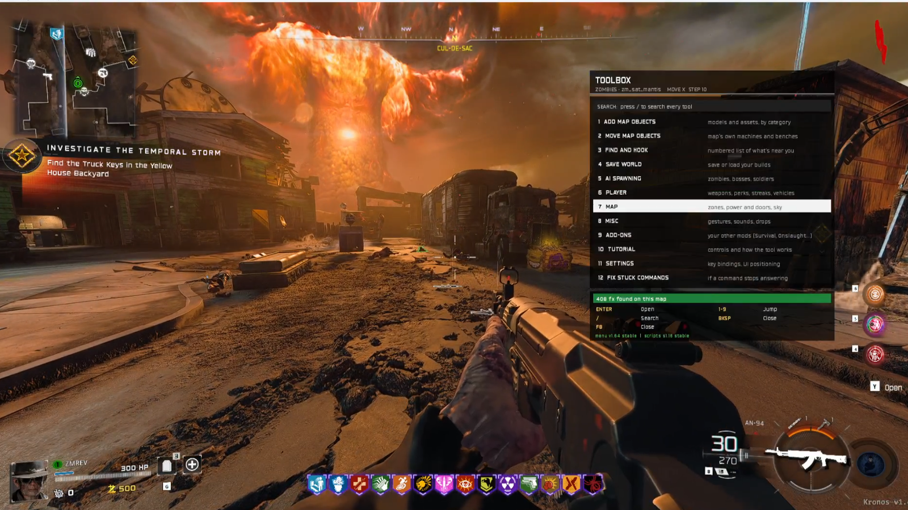

# BO7 World Builder

Build your own version of any map. Place props and machines, move or delete what's already there, spawn zombies and bosses, set your own map rules, and save the whole thing so you can load it again later.

Works in Multiplayer, Zombies and Endgame on Kronos.

Current version: **v1.69** (scripts s1.21)

---

## Installing

### From the Workshop (easiest)

1. Open the Kronos launcher and go to the Workshop.
2. Find **BO7 - World Builder** and install it.
3. Make sure it's switched on in your mod list.
4. Close the launcher completely and open it again, then start the game.

### By hand (from a release on this page)

1. Grab the zip from the [Releases](../../releases) page.
2. Unzip it. You'll get a folder called `forge_tool`.
3. Drop that folder into `cod25\kronos\mods\` so you end up with `cod25\kronos\mods\forge_tool\mod.json`.
4. Turn it on in the launcher (or set `"forge_tool": true` in `cod25\kronos\mods.json`).
5. Restart the launcher, not just the game.

**Heads up:** the very first map you load after installing or updating takes a bit longer while the scripts get built. Load into a private match on your own the first time and let it finish. After that it's fast.

If the menu footer still shows an old version number, you didn't restart the launcher. That one gets everybody.

---

## The basics

| Key | What it does |
|---|---|
| **F8** (or aim + knife) | Open / close the menu |
| **Hold F8** for 2 seconds | Put the menu back where it started |
| **Up / Down** | Move through rows |
| **Left / Right** | Change a pick (the rows with `<  >`) |
| **Enter** | Run the row |
| **Backspace** | Go back |
| **/** | Search |

Anything the game says back to you shows up in the hint bar at the bottom, and every page has a colored status bar. Green means it worked, red means it didn't (and it'll tell you why).

Some rows say **(Enter twice)**. Those are the ones that delete stuff, so you have to press Enter a second time within a few seconds to confirm.

Nothing runs on its own. You start every mode and every change yourself.

### Editing keys

Once you've hooked something (more on that below) these keys do the work:

| Key | What it does |
|---|---|
| **K** | Hook mode: grab whatever is in front of you |
| **Q / E** | Nudge it back / forward |
| **P** | Switch axis (X, Y, Z) |
| **U** | Switch between Move, Rotate and Scale |
| **H** | Hide / unhide it |
| **Del** twice | Delete it |
| **Z** | Undo the last change |
| **B** | Open Properties for a hooked machine |

Don't like these? Change any of them in **Settings > Key bindings**.

---

## Your first build (5 minutes)

This is the fastest way to get a feel for it.

1. Load into any map and press **F8**. You land on the **Toolbox**.
2. Pick **Add map objects** and choose a category, say **Props**. Scroll to something you like and press **Enter**. It shows up in front of you.
   - **Shift + Enter** places it and jumps you straight into editing it.
3. Now it's hooked. Use **Q / E** to slide it around, **P** to change axis, and **U** to switch to rotate or scale.
4. Want it somewhere exact? Open **Exact position** and type the X, Y, Z (or use **Copy my position** to drop it where you're standing).
5. Go back to the Toolbox and open **Save world**. Type a name, hit **Save layout**.
6. Restart the map, open **Save world** again, pick your save from **Existing saves** and hit **Load layout**. Everything comes back.

That's the whole loop. Add, hook, adjust, save.

---

## The Toolbox

The Toolbox is the first page you see. It's kept short on purpose.

- **Add map objects** - spawn models and full machines, sorted by category
- **Move map objects** - the map's own machines and benches (perks, Pack-a-Punch, wall buys, the box...)
- **Find and hook** - a numbered list of what's near you, so you can grab things that are hard to aim at
- **Save world** - save, load and manage your layouts
- **AI spawning** - zombies, bosses, soldiers, spawners
- **Player** - weapons, perks, points, armor, streaks, vehicles
- **Map** - zones, power and doors, rounds, sky, map rules
- **Misc** - gestures, sounds, drops
- **Add-Ons** - your other mods and the built-in game modes
- **Tutorial** - a short in-game version of this page
- **Settings** - key bindings, UI position, colors
- **Fix stuck commands** - press this if a row ever stops answering

There's a search box at the top too. Type part of a page name and jump straight to it.

---

## Everything it can do

### Building

- Place any model from the full model list, with search and filters (map, mode, category)
- Categories: Machines & assets, Buyable doors, Spawn points, Props, Furniture, Nature, Lighting, Static vehicles, Barriers, plus Recent and All models
- Place real working machines: perks, Pack-a-Punch, ammo crates, Arsenal, crafting bench, Mystery Box, Wunderfizz, Gobblegum
- Hook anything in front of you, or the closest thing you can interact with
- Move, rotate and scale with steps or typed values
- Exact position page: type X / Y / Z / yaw, or copy your own position and facing
- Bring object (pull the hooked thing in front of you)
- Go look at it (teleports you to the hooked object)
- Copy and paste objects
- Change model on a placed object, or reset it
- Make objects solid or not
- Hide or unhide anything, including parts of the map
- Undo
- Animate objects, and play the map's own asset animations on hooked objects
- Your Models list so you can find what you placed

### The map's own stuff

- Move the real perk machines, Pack-a-Punch, box, ammo, Arsenal, crafting bench, Wunderfizz and wall buys
- Copy them to new spots
- Remove all of a kind, then bring everything back with Restore all
- Turn power on, activate machines
- Teddy bear on or off for the Mystery Box

### Machine Properties

Hook a machine and press **B** (or Edit Object > Properties).

- Pack-a-Punch: Regular or Max
- Wall buys: weapon rarity, Common to Legendary
- Armor wall buys: golden armor
- Gobblegum: pack only or any gum, 3 spins a round or unlimited

Properties save with your layout.

### Doors, zones and power

- Open or close every door, or one at a time
- Lock, unlock or delete doors
- Place your own buyable door with any model and any price, or copy a map door
- Power on / off
- Teleport to any zone, open or close zones, only your zone on, Open All Zones
- Remove invisible clips you're looking at (and put them back)

### Map Rules

All of these save with your layout.

- Disable Objectives (also moves the main quest up to the boss)
- Disable Announcer
- Disable Special Rounds
- Disable Ash and Fog Spawns where the map has them
- Pack-a-Punch level 4
- Arsenal Ultra rarity
- Mystery Box: Regular, Never moves, or Always active
- Stay in this arena (Dead Ops)

### Rounds and enemies

- Next / previous round, jump to any round, reset to round 1, end the current round
- Start exfil or close the exfil window
- Change Enemy Type: swap normal round zombies for any other enemy, with health and alive limit settings
- Create Spawner: your own spawn spots with a marker, how many per wave, which rounds, and spawn effects

### AI spawning

- Quick spawn list, bosses, Zombies AI, Endgame AI, Multiplayer AI and other AI
- Spawn them hostile or friendly
- Kill the last one or all of them
- Multiplayer bots with team, weapon and skin picks

### Player

- Give any weapon (BO7, BO6, MW2, MW3, MW2019 and more), or drop it on the ground
- Attachments for the gun you're holding
- Weapon Enhancement (Experimental): Pack-a-Punch, rarity and ammo mod on your primary, secondary or knife, plus camos and blueprints
- Zombies perks and MP perks (including zombies perks in MP)
- Points and salvage: give, set or take
- Armor level and refill
- Lethals and tacticals
- Killstreaks and supply drops
- Vehicles
- Operator skin
- Gestures and animations

### Rewards and drops

- Build your own reward crate: rarity, points, salvage, a weapon (with rarity and Pack-a-Punch), equipment, a scorestreak
- Power-up drops for the map you're on, plus Multiplayer and event / boss drops

### Endgame and Survival

- Shop laptops: weapons, equipment, air support, perk station
- Exotic and Jailbreak benches
- Set your cash and change the wave

### Sky and effects

- Swap the skybox and rotate it
- Vision sets
- Spawn effects and stop them all at once

### Boss fights

- Start the boss fight, go to the boss arena, turn on just the boss zone, open everything

### Saving

- Save as many layouts per map as you want
- Load one, delete one, list them
- **Load default** restarts the map and loads your default layout for it
- **Start Mode** gives you a fresh round 1 on your layout: M1911, knife, frags, and your perks, salvage and armor reset
- Saves keep your objects, machine settings and map rules

### Add-Ons and game modes

- **Gun Game** - set kills per gun and your own gun list
- **Chaos Mode** - set the start time and how fast it ramps up
- **Zombie Battle** (Zombies)
- Shortcuts to your other mods if they're installed: Survival (MP Zombies), Onslaught, Endgame, Boss Fights

### Settings

- Rebind every editing key
- Move the menu and the hint bar anywhere on screen
- Change the menu colors
- Scripts: write little scripts of console lines in a built-in notepad, then run or stop them
- Hide unavailable items (on by default, turn it off to see everything)

---

## Tips

- **Restart the launcher after every update.** If something looks old, this is why.
- Things that are baked into the map (part of the level itself) can't be hooked. If K grabs nothing, try **Find and hook**.
- If a row stops responding, use **Fix stuck commands** on the Toolbox.
- Rows that don't work in the mode you're in are hidden. Turn off **Hide unavailable items** if you want to see them anyway.
- Your layouts live in `cod25\kronos\world\`. Back that folder up if you care about your builds.

## Known issues

- Placed copies of perk machines may not sell on some maps (Mantis, Zarya). Moving the map's own perk machine works fine. This is being worked on for v1.70.
- Multiplayer skybox and vision changes don't work yet.

## Updating

Workshop: just update it in the launcher, then restart the launcher.

By hand: replace the `forge_tool` folder with the new one. Your saved layouts are in a different folder, so they stay.

---

Made by ZMRev. Questions or bugs? Open an issue on this page.
